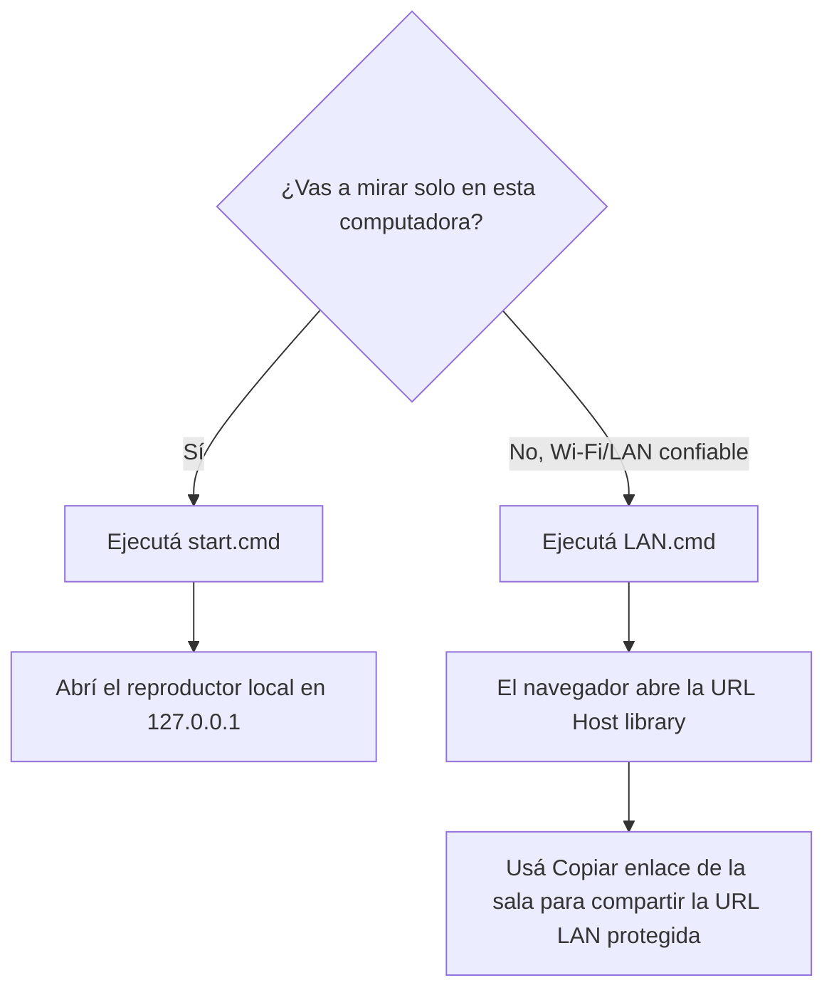

# The Player

[English](README.md)

The Player es un reproductor de video en el navegador para una playlist local. Recuerda el progreso en tu navegador y, opcionalmente, puede crear una sala temporal compartida en una LAN confiable.

## Descarga e inicio

**Portátil de Windows v1.5.4** — [descargá el ZIP](https://github.com/Dortecx/The-Player/releases/download/v1.5.4/The-Player-1.5.4-windows.zip), descomprimilo y abrí la carpeta extraída `The-Player-1.5.4-windows`.



- `start.cmd` es **solo local** e inicia con reproducción directa y sin token del navegador: usalo para archivos que quedan en este navegador. Elegí **Usar pistas internas locales** solo cuando sea necesario; esa acción explícita sube los archivos locales actuales a una nueva sesión administrada solo por loopback y no compartible para usar el pipeline HLS compatible de audio/subtítulos internos.
- `LAN.cmd` inicia explícitamente el **modo compartido**: usalo solo si el host y los clientes están en la misma Wi-Fi/LAN confiable.
- Cada launcher abre el navegador automáticamente cuando el servidor está listo y mantiene abierta su consola. Usá `Ctrl+C` para un apagado normal. Hacer clic en la **X** de la ventana puede terminar Node antes de que se ejecute su limpieza; es una limitación del cierre de consola de Windows, no una ruta de señal confiable.
- Las subidas de la sesión portátil y el HLS en curso viven solo en `runtime-media` dentro del paquete. En cada inicio, el launcher elimina ese directorio solo si coincide su marcador de propiedad adyacente de The Player; nunca borra el temporal del sistema, `logs` ni otros archivos portátiles. Las versiones compatibles terminadas viven en el `hls-cache` marcado junto al launcher para reutilizarse después de reiniciar. Esa caché es medio derivado persistente: eliminá manualmente la carpeta marcada `hls-cache` para vaciarla; Vaciar biblioteca y el apagado normal la conservan.
- El ZIP incluye `runtime\node.exe`, `runtime\ffmpeg.exe` y `runtime\ffprobe.exe`; quienes usan el paquete no necesitan Node.js, FFmpeg, npm ni `npm install`.

## Reproducción local

1. Ejecutá `start.cmd`; abre automáticamente el reproductor local en el navegador.
2. Mantené abierta la consola del launcher mientras usás el reproductor; al cerrarla se detiene el servidor local.
3. Elegí **Carpeta** o **Archivo** en la página del navegador.
4. Elegí un elemento de la playlist y miralo. El progreso, el estado visto y la actividad reciente quedan en IndexedDB del navegador.

Usá Anterior, Saltar siguiente y Marcar visto y seguir para navegar. Buscar filtra la playlist visible sin cambiar el orden de reproducción. Las extensiones soportadas son `.mp4`, `.webm`, `.m4v`, `.mov` y `.mkv` con soporte limitado; la reproducción depende de los códecs que soporte el navegador.

En navegadores compatibles con la API Screen Wake Lock, la pantalla se mantiene activa mientras se sube un archivo, se prepara una transmisión compatible elegida o la inmediata siguiente, o se reproduce video. Se libera cuando el video queda en pausa y no hay subidas ni preparación, y cuando la página está oculta; los navegadores no compatibles o las solicitudes denegadas siguen funcionando normalmente.

## Compartir por LAN

1. En el host, ejecutá `LAN.cmd` y permití Node en el Firewall de Windows para redes **privadas** si aparece el aviso.
2. El navegador abre automáticamente la **Host library URL** con token (`127.0.0.1`); ahí elegí archivos o una carpeta.
3. Mantené abierta la consola del launcher mientras la sala esté en uso. Usá `Ctrl+C` para solicitar un apagado normal. Si la cerrás con la **X**, Windows puede terminar Node sin ejecutar la limpieza; iniciá cualquiera de los launchers otra vez para recuperar de forma segura la sesión obsoleta de `runtime-media`.
4. Usá el control **Copiar enlace de la sala** de la app para copiar la URL canónica protegida de sala LAN y enviásela a los clientes sin modificarla.
5. Los clientes abren esa URL copiada desde la misma Wi-Fi/LAN y pueden seleccionar, reproducir, pausar, buscar y navegar juntos.

El token es un secreto de portador: no publiques la URL completa. Esto no es para compartir por Internet. Los invitados no pueden subir ni vaciar la biblioteca del host. Los archivos compartidos temporales se eliminan al detener normalmente el servidor; después de cerrar con X, el siguiente inicio portátil elimina solo su directorio `runtime-media` marcado.

Para el comportamiento y los límites de subida, los permisos de host/invitado, los gestos móviles a pantalla completa y la lista de validación en dos navegadores, consultá [los detalles de reproducción compartida por LAN](docs/lan-shared-playback.es.md).

## Límites

- `start.cmd` conserva la reproducción local cruda, los controles nativos del navegador y ninguna subida/conversión hasta elegir **Usar pistas internas locales**. Esa acción crea una sesión administrada solo por loopback protegida con token, sube los archivos actuales, oculta el enlace para compartir y usa la misma inspección, HLS de pistas elegidas, superposición agregada de subtítulos, recuperación cruda y reanudación cuando sea posible. El comportamiento LAN no cambia. Cuando un video compartido subido tiene alternativas internas inspeccionadas, el host elige audio y un subtítulo de texto opcional en **Pistas internas**, y luego usa **Aplicar pistas y recargar** antes de que HLS comience. La elección es autoritativa y los invitados la ven en solo lectura. Los cambios posteriores recargan deliberadamente la fuente HLS compartida y se reanudan lo más cerca posible según los metadatos del navegador; no son cambios sin cortes. Hasta que el host aplique una elección, la reproducción cruda protegida permanece disponible.
- Las pistas elegidas usan el cliente `hls.js` local incluido (o el soporte HLS nativo del navegador), nunca un CDN. El ZIP portátil incluye ese recurso de navegador y su aviso Apache-2.0, por lo que las personas usuarias no instalan nada.
- Al aplicar una elección se genera un VOD HLS multiplexado CMAF/fMP4 orientado a Chrome MSE. Primero se remultiplexan video H.264 `yuv420p` progresivo de 8 bits y audio AAC-LC mono/estéreo compatibles; cuando solo uno es incompatible, se convierte solo ese flujo; en otro caso se convierten ambos a H.264/AAC. La conversión de subtítulos de texto es independiente y nunca obliga a convertir A/V. Por proceso, FFmpeg valida NVENC, luego QSV y luego AMF solo cuando es necesario convertir video; las rutas de copia o de solo conversión de audio no prueban GPU. Usa el primer codificador funcional o `libx264` si no hay acelerador utilizable. La decodificación sigue siendo solo por software. Un fallo de codificación GPU reintenta una vez con salida nueva de `libx264` y pone en cuarentena ese backend GPU durante el resto del proceso solo si el reintento funciona. Usá `REPRODUCTOR_FORCE_CPU_ENCODER=1` para forzar CPU determinista (pruebas/diagnóstico). La primera vez que se usa una combinación de fuente y pistas se espera mientras FFmpeg convierte el VOD completo; el navegador no adjunta HLS, no reproduce automáticamente ni guarda progreso durante la conversión. La versión queda lista, con duración completa y posición reanudada vinculada al contenido, solo después de que FFmpeg termine correctamente y cada referencia del manifiesto sea segura, exista y esté completa (`#EXT-X-ENDLIST`). Luego se promueve de forma atómica a la caché persistente cuando está disponible; si la persistencia no está disponible, la misma versión completa validada de sesión sigue siendo segura para reproducir. Más adelante, subir los mismos bytes de origen con las mismas pistas reutiliza la caché de inmediato y no inicia FFmpeg. Las claves de caché contienen solo SHA-256 del contenido de origen, índices de pistas elegidas e identidades del codificador que tuvo éxito/topología; no se guardan rutas de origen ni tokens de sala. Una entrada terminada y totalmente validada puede reutilizarse entre perfiles de codificador solo cuando su perfil seguro registrado y su grafo completo de artefactos coinciden con el mismo origen y selección de pistas. No usa grupos HLS de audio alternativo ni cambios de pista de audio en el navegador. Admite ASS/SSA, SRT/SubRip, WebVTT, MOV text, text y TTML; los subtítulos de imagen/mapa de bits no se pueden elegir. El trabajo VOD completo tiene un plazo según la duración (mínimo 30 minutos, hasta 12 horas) y comunica `job-timeout` si alcanza ese límite. Si la conversión falla o se cancela, no se reproduce HLS parcial; usá la acción explícita para recuperar el video original. Cada cliente que use esa recuperación debe admitir el contenedor **y los códecs** del archivo original.
- Mientras se prepara una transmisión completa elegida, el host y las personas invitadas ven la misma superposición compacta en el borde inferior del reproductor. Empieza indeterminada; después de que FFmpeg informa tiempo de salida para una duración de origen conocida, muestra porcentaje según duración, tiempo transcurrido y un tiempo restante solo cuando se puede calcular. En otro caso indica que el tiempo restante no está disponible. El estado autoritativo de sala solo contiene progreso numérico normalizado; nunca salida de FFmpeg, rutas, comandos, tokens, errores sin procesar ni detalles de controladores.
- Cuando la transmisión compatible elegida está lista, el servidor puede preparar exactamente el elemento inmediato siguiente de la playlist (incluido uno agregado mientras termina la conversión de primer plano) resolviendo la huella de audio/subtítulos elegida para ese episodio: idioma normalizado más título y disposición coincidentes cuando están disponibles, y luego solo idioma si no es ambiguo. Nunca traslada índices globales de FFprobe entre episodios ni adivina una coincidencia ambigua; en ese caso la tarjeta siguiente pide al host elegir pistas coincidentes. La preparación mantiene sin cambios la selección del elemento de primer plano. Al promocionarse, los índices resueltos del siguiente pasan a ser la selección de primer plano, de modo que la reproducción y las claves de caché usan las pistas previstas para ese episodio. Solo esa tarjeta siguiente muestra para host e invitados una etiqueta segura de preparando/listo/no disponible/elección requerida. Solo las transiciones de propiedad programan, cancelan o promocionan este trabajo; una solicitud GET/HEAD únicamente observa un plan ya autorizado, espera la limpieza de cancelación durante un intervalo acotado y nunca inicia ni desplaza FFmpeg. Una selección en primer plano desplaza el trabajo especulativo; cambiar pistas, destino de lista, vaciar o apagar lo cancela. La promoción reutiliza el plan preparado y nunca recarga ni altera el elemento que antes estaba en primer plano.
- El límite predeterminado de subida compartida es 100 GiB por archivo; consultá los [detalles LAN](docs/lan-shared-playback.es.md#ciclo-de-carga-y-límites) para cambiarlo antes de iniciar.

## Ejecutar desde el código fuente o crear el ZIP portátil

Para un checkout de código fuente, instalá Node.js 18+ y npm:

```bash
git clone https://github.com/Dortecx/The-Player.git
cd The-Player
npm run web
```

El servidor desde código fuente es solo local de forma predeterminada. Para compartir, iniciá con `SHARE_LAN=1` (`set "SHARE_LAN=1" && npm run web` en Windows Command Prompt, `$env:SHARE_LAN = '1'; npm run web` en PowerShell, o `SHARE_LAN=1 npm run web` en Linux/WSL).

Para crear el ZIP portátil de Windows en Windows:

```powershell
npm run build:portable:win
```

Esto crea `portable-win\The-Player-1.5.5-windows.zip`. El build de Windows descarga el archivo GPL de FFmpeg BtbN de 64 bits fijado por SHA-256, rechaza una diferencia, y empaqueta sus binarios FFmpeg/FFprobe, aviso GPL y avisos extraídos del archivo. Ese runtime incluye `libx264`; el build valida una fixture MKV con subtítulo de texto interno → HLS/WebVTT H.264/x264. Requiere Internet durante el build; las personas usuarias no instalan nada extra. El ZIP del release y el ZIP generado incluyen `start.cmd` (solo local) y `LAN.cmd` (modo compartido). La fixture fMP4 verifica los artefactos y manifiestos generados, pero no prueba la reproducción en navegador; completá la comprobación LAN manual antes de afirmar que Chrome reproduce.

Repositorio: <https://github.com/Dortecx/The-Player> · Release: <https://github.com/Dortecx/The-Player/releases/tag/v1.5.4>

## Licencia

Licencia MIT. Ver [LICENSE](LICENSE).
