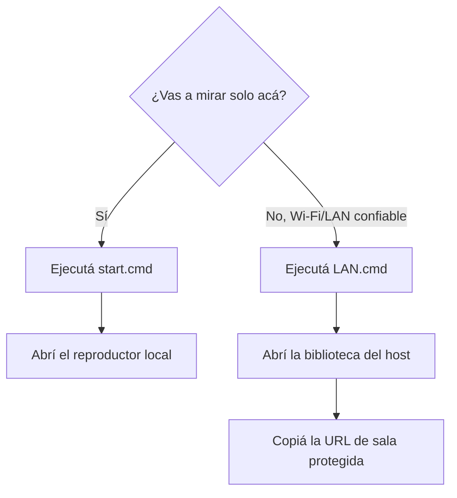
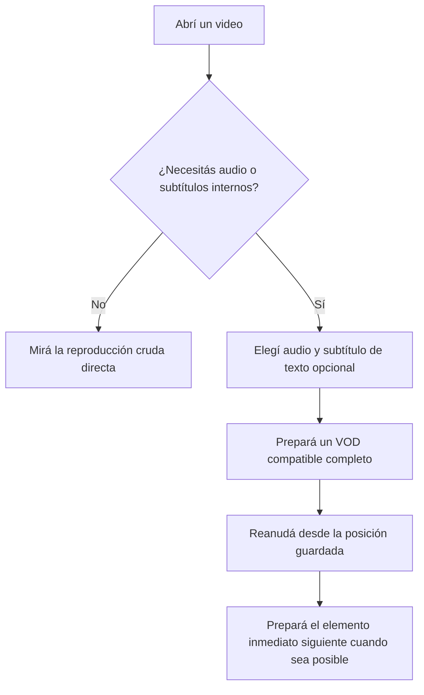

# The Player

[English](README.md)

The Player es un reproductor de video en el navegador para una playlist local. Recuerda el progreso del navegador y, opcionalmente, puede alojar una sala temporal en una LAN confiable.

## Descarga e inicio

**Portátil de Windows v1.5.7** — [descargá el ZIP](https://github.com/Dortecx/The-Player/releases/download/v1.5.7/The-Player-1.5.7-windows.zip), descomprimilo y abrí `The-Player-1.5.7-windows`.



- **`start.cmd`** es solo local. Abre archivos directos al instante; elegí **Usar pistas internas locales** solo cuando necesites audio o subtítulos de texto internos.
- **`LAN.cmd`** es el modo compartido para una Wi-Fi/LAN confiable. Abre la biblioteca del host; compartí la URL de sala de la app, nunca un enlace público.
- Mantené abierta la consola del launcher y usá `Ctrl+C` para apagar normalmente. El ZIP ya incluye Node, FFmpeg y FFprobe.

## Camino rápido

### Reproducción local

1. Ejecutá `start.cmd`.
2. Elegí **Carpeta** o **Archivo** y después un elemento de la playlist.
3. Para audio/subtítulos MKV internos, elegí **Usar pistas internas locales**, seleccioná las pistas y aplicalas.

La ruta directa permanece cruda y no sube ni convierte nada. La acción explícita de pistas crea una sesión local solo por loopback y no compartible. El progreso, estado visto y actividad reciente quedan en IndexedDB del navegador.

### Compartir por LAN

1. Ejecutá `LAN.cmd` y permití Node en el Firewall de Windows para redes **privadas** si aparece el aviso.
2. Agregá medios en el navegador del host y usá **Copiar enlace de la sala**.
3. Enviá esa URL completa solo a personas de la misma LAN confiable.

El token de sala es un secreto de portador. Las personas invitadas controlan la reproducción, pero no pueden subir, reemplazar ni vaciar la biblioteca del host. Consultá los [detalles de reproducción compartida por LAN](docs/lan-shared-playback.es.md).

## Pistas internas, de un vistazo



| Tema | Qué esperar |
| --- | --- |
| Preparación | El reproductor espera un VOD completo y validado; nunca inicia HLS parcial. |
| Subtítulos | Las pistas de texto compatibles se muestran mediante una superposición WebVTT agregada y protegida. Los subtítulos de imagen no están disponibles. |
| Caché | Las versiones compatibles terminadas quedan en `hls-cache`, una carpeta marcada; eliminála manualmente para vaciar medios derivados. |
| Reanudación | Cada elemento de la playlist conserva un checkpoint vinculado al contenido, incluso en navegación rápida A/B/C. |
| Recuperación | Si la preparación falla, usá la acción de video original; el navegador debe admitir el contenedor y códecs de ese archivo. |

Para códecs, rutas HLS, estados de conversión, fallback GPU/CPU, seguridad de caché y navegación de preparación anticipada, consultá los [detalles de reproducción con pistas elegidas](docs/selected-track-playback.es.md).

## Ejecutar desde el código fuente o crear el ZIP portátil

Para un checkout de código fuente, instalá Node.js 18+ y npm:

```bash
git clone https://github.com/Dortecx/The-Player.git
cd The-Player
npm run web
```

El servidor desde código fuente es solo local de forma predeterminada. Para compartir, iniciá con `SHARE_LAN=1`.

Para crear el ZIP portátil de Windows:

```powershell
npm run build:portable:win
```

El build requiere Windows PowerShell 5.1, `node.exe` de Windows 18+, `curl.exe` y acceso a Internet. El archivo FFmpeg está fijado por SHA-256; una descarga interrumpida conserva solo un parcial acotado y de identidad coincidente para reanudar con seguridad. El build verifica el hash final antes de extraerlo. Las personas usuarias no instalan nada extra.

Repositorio: <https://github.com/Dortecx/The-Player> · Release: <https://github.com/Dortecx/The-Player/releases/tag/v1.5.7>

## Licencia

Licencia MIT. Ver [LICENSE](LICENSE).
