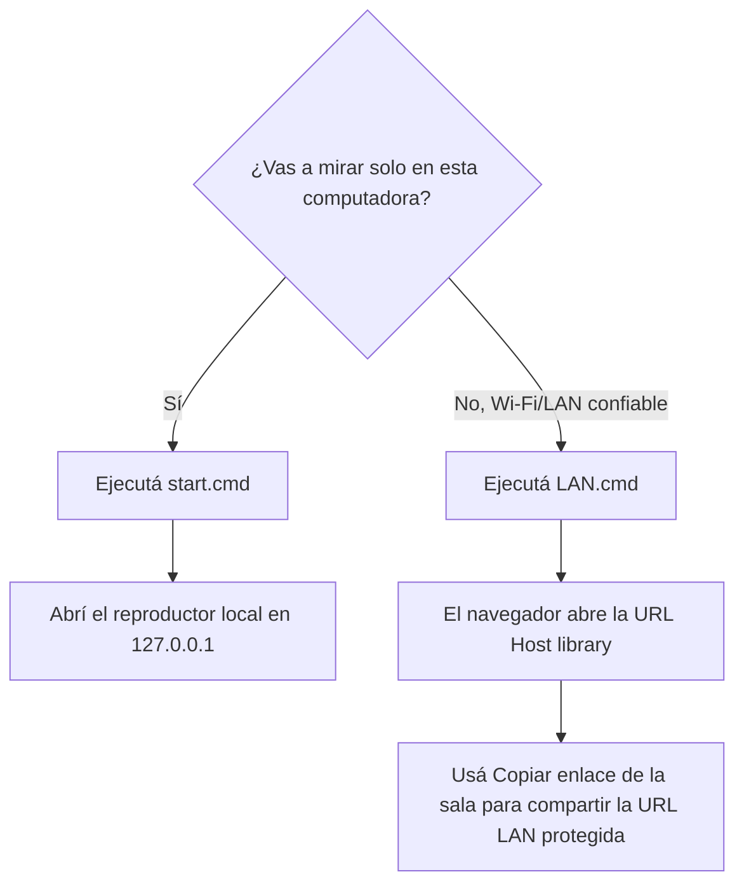

# The Player

[English](README.md)

The Player es un reproductor de video en el navegador para una playlist local. Recuerda el progreso en tu navegador y, opcionalmente, puede crear una sala temporal compartida en una LAN confiable.

## Descarga e inicio

**Portátil de Windows v1.5.4** — [descargá el ZIP](https://github.com/Dortecx/The-Player/releases/download/v1.5.4/The-Player-1.5.4-windows.zip), descomprimilo y abrí la carpeta extraída `The-Player-1.5.4-windows`.



- `start.cmd` es **solo local**: usalo para archivos que quedan en este navegador.
- `LAN.cmd` inicia explícitamente el **modo compartido**: usalo solo si el host y los clientes están en la misma Wi-Fi/LAN confiable.
- Cada launcher abre el navegador automáticamente cuando el servidor está listo y mantiene su consola como dueña del ciclo de vida del servidor. Cerrá esa consola para detener su servidor.
- El ZIP incluye `runtime\node.exe`, `runtime\ffmpeg.exe` y `runtime\ffprobe.exe`; quienes usan el paquete no necesitan Node.js, FFmpeg, npm ni `npm install`.

## Reproducción local

1. Ejecutá `start.cmd`; abre automáticamente el reproductor local en el navegador.
2. Mantené abierta la consola del launcher mientras usás el reproductor; al cerrarla se detiene el servidor local.
3. Elegí **Carpeta** o **Archivo** en la página del navegador.
4. Elegí un elemento de la playlist y miralo. El progreso, el estado visto y la actividad reciente quedan en IndexedDB del navegador.

Usá Anterior, Saltar siguiente y Marcar visto y seguir para navegar. Buscar filtra la playlist visible sin cambiar el orden de reproducción. Las extensiones soportadas son `.mp4`, `.webm`, `.m4v`, `.mov` y `.mkv` con soporte limitado; la reproducción depende de los códecs que soporte el navegador.

## Compartir por LAN

1. En el host, ejecutá `LAN.cmd` y permití Node en el Firewall de Windows para redes **privadas** si aparece el aviso.
2. El navegador abre automáticamente la **Host library URL** con token (`127.0.0.1`); ahí elegí archivos o una carpeta.
3. Mantené abierta la consola del launcher mientras la sala esté en uso; al cerrarla se detiene el servidor compartido y termina la sala.
4. Usá el control **Copiar enlace de la sala** de la app para copiar la URL canónica protegida de sala LAN y enviásela a los clientes sin modificarla.
5. Los clientes abren esa URL copiada desde la misma Wi-Fi/LAN y pueden seleccionar, reproducir, pausar, buscar y navegar juntos.

El token es un secreto de portador: no publiques la URL completa. Esto no es para compartir por Internet. Los invitados no pueden subir ni vaciar la biblioteca del host, y los archivos compartidos temporales se eliminan al detener normalmente el servidor.

Para el comportamiento y los límites de subida, los permisos de host/invitado, los gestos móviles a pantalla completa y la lista de validación en dos navegadores, consultá [los detalles de reproducción compartida por LAN](docs/lan-shared-playback.es.md).

## Límites

- Cuando un video compartido subido tiene pistas internas inspeccionadas, el host puede elegir el audio y el subtítulo de texto opcional en **Pistas internas**. La selección es estado autoritativo de la sala: los invitados la ven en modo de solo lectura y todos los clientes convergen en ella. La reproducción solo local conserva sus controles nativos del navegador.
- Las pistas elegidas usan el cliente `hls.js` local incluido (o el soporte HLS nativo del navegador), nunca un CDN. El ZIP portátil incluye ese recurso de navegador y su aviso Apache-2.0, por lo que las personas usuarias no instalan nada.
- La selección HLS copia el video de origen (mientras genera audio AAC y subtítulos de texto WebVTT), por lo que requiere un flujo de video de origen compatible con el navegador y subtítulos de texto que admita el servidor (ASS/SSA, SRT/SubRip, WebVTT, MOV text, text o TTML). Los subtítulos de imagen/mapa de bits no se pueden elegir. Para un cliente HLS no disponible o video de origen incompatible, la reproducción vuelve sin destruir nada al video compartido original con un estado dentro de la app; cada cliente debe admitir el contenedor **y los códecs** de ese archivo.
- El límite predeterminado de subida compartida es 100 GiB por archivo; consultá los [detalles LAN](docs/lan-shared-playback.es.md#ciclo-de-carga-y-límites) para cambiarlo antes de iniciar.

## Ejecutar desde el código fuente o crear el ZIP portátil

Para un checkout de código fuente, instalá Node.js 18+ y npm:

```bash
git clone https://github.com/Dortecx/The-Player.git
cd The-Player
npm run web
```

El servidor desde código fuente es solo local de forma predeterminada. Para compartir, iniciá con `SHARE_LAN=1` (`set "SHARE_LAN=1" && npm run web` en Windows Command Prompt, `$env:SHARE_LAN = '1'; npm run web` en PowerShell, o `SHARE_LAN=1 npm run web` en Linux/WSL).

Para crear el ZIP portátil de Windows en Windows:

```powershell
npm run build:portable:win
```

Esto crea `portable-win\The-Player-1.5.4-windows.zip`. El build de Windows descarga el archivo LGPL de FFmpeg BtbN de 64 bits fijado, rechaza un SHA-256 distinto, copia sus binarios FFmpeg/FFprobe y avisos dentro del ZIP, y luego valida una fixture MKV con subtítulo de texto interno → HLS/WebVTT con video copiado. Requiere Internet durante el build; las personas usuarias no instalan nada extra. El ZIP del release y el ZIP generado incluyen `start.cmd` (solo local) y `LAN.cmd` (modo compartido).

Repositorio: <https://github.com/Dortecx/The-Player> · Release: <https://github.com/Dortecx/The-Player/releases/tag/v1.5.4>

## Licencia

Licencia MIT. Ver [LICENSE](LICENSE).
