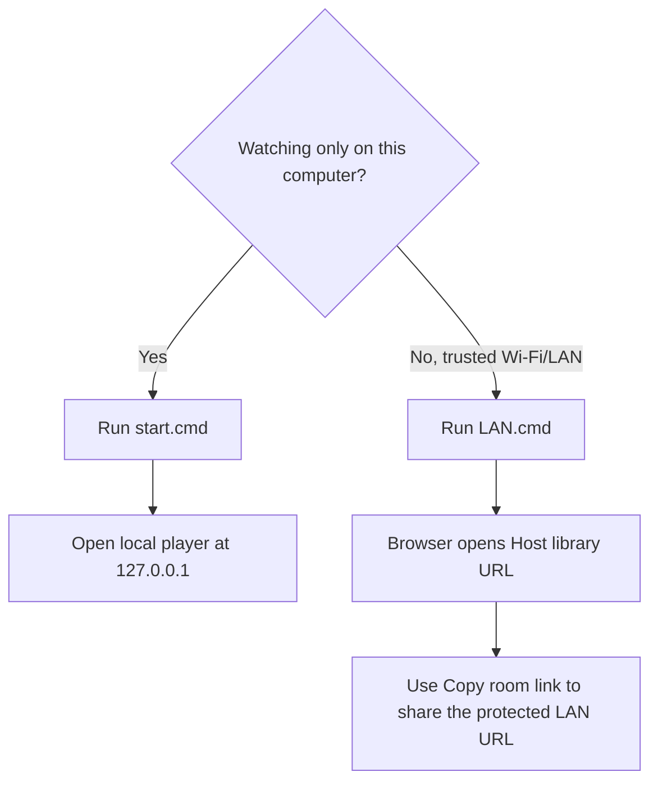

# The Player

[Español](README.es.md)

The Player is a browser-based video player for a local playlist. It remembers progress in your browser and can optionally host a temporary shared room on a trusted LAN.

## Download and start

**Windows portable v1.5.5** — [download the ZIP](https://github.com/Dortecx/The-Player/releases/download/v1.5.5/The-Player-1.5.5-windows.zip), unzip it, then open the extracted `The-Player-1.5.5-windows` folder.



- `start.cmd` is **local-only** and starts with direct, untokenized browser playback: use it for files that stay in this browser. Select **Use local embedded tracks** only when needed; that explicit action uploads the current local files into a new loopback-only, non-shareable managed session so embedded audio/text subtitles can use the existing compatible HLS pipeline.
- `LAN.cmd` explicitly starts **shared mode**: use it only when the host and clients are on the same trusted Wi-Fi/LAN.
- Each launcher opens the browser automatically after the server is ready and keeps its console open. Press `Ctrl+C` for a normal shutdown. Clicking the console window **X** can terminate Node before its cleanup handler runs; this is a Windows console-close limitation, not a reliable signal route.
- Portable session uploads and in-progress HLS live only in the package's `runtime-media` directory. At every launcher startup, it removes that directory only when its adjacent ownership marker matches The Player; it never clears the system temp directory, `logs`, or other portable files. Completed compatible renditions instead live in the separately marked `hls-cache` beside the launcher so they can be reused after restart. That cache is persistent derived media: delete the marked `hls-cache` folder manually to clear it; normal library Clear and shutdown preserve it.
- The ZIP includes `runtime\node.exe`, `runtime\ffmpeg.exe`, and `runtime\ffprobe.exe`; end users do not need Node.js, FFmpeg, npm, or `npm install`.

## Local playback

1. Run `start.cmd`; it opens the local player in your browser automatically.
2. Keep the launcher console open while using the player; closing it stops the local server.
3. Choose **Folder** or **File** in the browser page.
4. Choose a playlist item and watch. Progress, watched state, and recent activity stay in browser IndexedDB.

Use Previous, Skip next, and Mark watched & next to navigate. Search filters the visible playlist without changing playback order. Supported extensions are `.mp4`, `.webm`, `.m4v`, `.mov`, and best-effort `.mkv`; playback depends on browser codec support.

On browsers that support the Screen Wake Lock API, the display stays awake while a file uploads, a selected or immediate next compatible stream is preparing, or video is playing. It is released when playback is paused and no upload or preparation remains, and while the page is hidden; unsupported browsers or denied requests continue normally.

## Share on a LAN

1. On the host, run `LAN.cmd` and allow Node through Windows Firewall on **Private** networks if prompted.
2. The browser opens the tokenized **Host library URL** (`127.0.0.1`) automatically; choose files or a folder there.
3. Keep the launcher console open while the room is in use. Use `Ctrl+C` to request normal shutdown. If you close it with **X**, Windows can terminate Node without running cleanup; start either launcher again to safely recover the stale `runtime-media` session.
4. Use the in-app **Copy room link** control to copy the canonical protected LAN room URL, then send it to clients unchanged.
5. Clients open that copied URL on the same Wi-Fi/LAN and can select, play, pause, seek, and navigate together.

The token is a bearer secret: do not post the full URL. This is not Internet sharing. Guests cannot upload or clear the host library. Temporary shared files are removed on ordinary server shutdown; after an X-close, the next portable launcher startup removes only its marked `runtime-media` directory.

For upload behavior and limits, host/guest permissions, mobile fullscreen gestures, and the two-browser validation checklist, see [LAN shared playback details](docs/lan-shared-playback.md).

## Limits

- `start.cmd` keeps raw local playback, native browser controls, and no upload/conversion until **Use local embedded tracks** is selected. That action creates a token-protected loopback-only managed session, uploads the current files, hides room-link sharing, and then uses the same inspection, selected-track HLS, aggregate subtitle overlay, raw fallback, and best-effort resume behavior. LAN behavior is unchanged. When an uploaded shared video has inspected alternatives, the host chooses audio and an optional text subtitle in **Embedded tracks**, then uses **Apply tracks and reload** before HLS starts. The choice is authoritative and guests see it read-only. Later changes deliberately reload the shared HLS source and resume as closely as browser metadata allows; they are not seamless switches. Until the host applies a choice, protected raw playback remains available.
- Selected tracks use the bundled local `hls.js` client (or a browser's native HLS support), never a CDN. The portable ZIP includes that browser asset and its Apache-2.0 notice, so end users install nothing.
- Applying a choice generates one Chrome MSE-targeted muxed CMAF/fMP4 HLS VOD. Compatible H.264 8-bit progressive `yuv420p` video and AAC-LC mono/stereo audio are remuxed first; when only one is incompatible, only that stream is converted; otherwise both are converted to H.264/AAC. Text subtitle conversion remains independent and never forces A/V conversion. Per process, FFmpeg capability-checks NVENC, then QSV, then AMF only when video conversion is necessary; copy and audio-only routes do not probe a GPU. It uses the first working encoder or `libx264` when no accelerator is usable. Decoding remains software-only. A GPU encode failure retries once with fresh `libx264` output and quarantines that GPU backend for the rest of the process only after the retry succeeds. Set `REPRODUCTOR_FORCE_CPU_ENCODER=1` to force deterministic CPU encoding (for tests/troubleshooting). The first use of a source-and-track choice waits while FFmpeg converts the complete VOD; the browser does not attach HLS, autoplay, or save progress during conversion. Only after FFmpeg succeeds and every manifest reference is safe, present, and complete (`#EXT-X-ENDLIST`) is the rendition ready, with its full duration and matching content-bound resume position. It is then atomically promoted to the persistent cache when available; if persistence is unavailable, the same validated completed session rendition is still safe to play. Later uploads of the same source bytes with the same picks reuse that cache immediately and start no FFmpeg. Cache keys contain only source-content SHA-256, selected track indexes, and the successful encoder/topology identities; source paths and room tokens are not stored. A fully validated completed entry may be reused across encoder profiles only after its safe recorded profile and complete artifact graph match the same source and track selection. It does not use alternate-audio HLS groups or browser audio-track switching. Supported text subtitles are ASS/SSA, SRT/SubRip, WebVTT, MOV text, text, and TTML; image/bitmap subtitles are not selectable. The full VOD job has a duration-aware deadline (minimum 30 minutes, up to 12 hours) and reports `job-timeout` if that bound is reached. If conversion fails or is cancelled, no partial HLS is played; use the explicit original-video recovery action instead. Every client using that recovery must support the original file's container **and codecs**.
- While a complete selected stream is preparing, the host and guests see the same compact lower-edge player overlay. It begins indeterminate; after FFmpeg reports output time for a known source duration, it shows duration-aware percent, elapsed time, and an ETA only when that estimate is computable. Otherwise it says that ETA is unavailable. The authoritative room state carries only normalized numeric progress, never FFmpeg output, paths, commands, tokens, raw errors, or driver details.
- Once the selected compatible stream is ready, the server may prepare exactly the immediate next playlist item (including an item appended while foreground conversion finishes) by resolving the selected audio/subtitle fingerprint against that episode: normalized language plus matching title and disposition when available, then language alone only when it is unambiguous. It never carries global FFprobe indexes between episodes or guesses an ambiguous match; the next card instead asks the host to choose matching tracks. Preparation keeps the foreground item's selection unchanged. On promotion, the resolved next indexes become the foreground selection, so playback and cache keys use that episode's intended tracks. Only that next card shows a safe preparing/ready/unavailable/choice-required label for host and guests. Owner transitions alone schedule, cancel, or promote this work; a GET/HEAD request only observes an already-authorized plan, waits through cancellation cleanup for a bounded interval, and never starts or preempts FFmpeg. Selecting a still-preparing destination keeps the foreground item and its checkpoint unchanged. Backward navigation may retain a later one-ahead preparation, and a ready session may be re-admitted without re-encoding. Each playlist item keeps its own content-bound checkpoint. Changing tracks, clearing, or shutdown cancels speculative work. Promotion reuses a prepared plan and never reloads or alters the previously foreground item.
- The default shared upload cap is 100 GiB per file; see the [LAN details](docs/lan-shared-playback.md#upload-lifecycle-and-limits) to change it before startup.

## Run from source or build the portable ZIP

For a source checkout, install Node.js 18+ and npm:

```bash
git clone https://github.com/Dortecx/The-Player.git
cd The-Player
npm run web
```

The source server is local-only by default. To share, start it with `SHARE_LAN=1` (`set "SHARE_LAN=1" && npm run web` in Windows Command Prompt, `$env:SHARE_LAN = '1'; npm run web` in PowerShell, or `SHARE_LAN=1 npm run web` on Linux/WSL).

To build the Windows portable ZIP on Windows:

```powershell
npm run build:portable:win
```

This creates `portable-win\The-Player-1.5.5-windows.zip`. Building requires Windows PowerShell 5.1, Windows `node.exe` 18+, `curl.exe`, and Internet access. The Windows build downloads the SHA-256-pinned BtbN 64-bit GPL FFmpeg archive, refuses a mismatch, and retains only an identity-matched bounded partial when an interrupted download can be resumed safely. It verifies the complete hash before extraction and packages its FFmpeg/FFprobe binaries, GPL notice, and extracted archive notices. That runtime includes `libx264`; the build validates an embedded-text-subtitle MKV → H.264/x264 HLS/WebVTT fixture. End users install nothing extra. The release ZIP and generated ZIP include both `start.cmd` (local-only) and `LAN.cmd` (shared mode). The fMP4 fixture verifies generated artifacts and manifests, but it is not browser-playback proof; complete the manual LAN check before claiming Chrome playback.

Repository: <https://github.com/Dortecx/The-Player> · Release: <https://github.com/Dortecx/The-Player/releases/tag/v1.5.5>

## License

MIT License. See [LICENSE](LICENSE).
