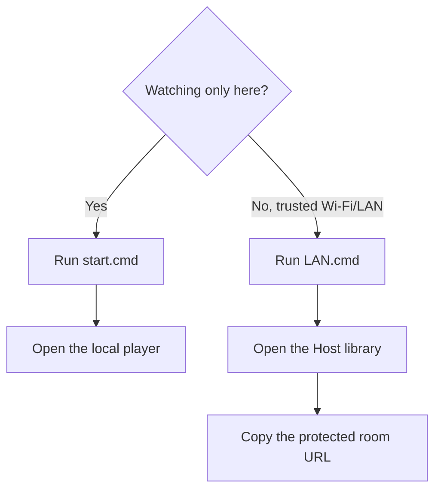
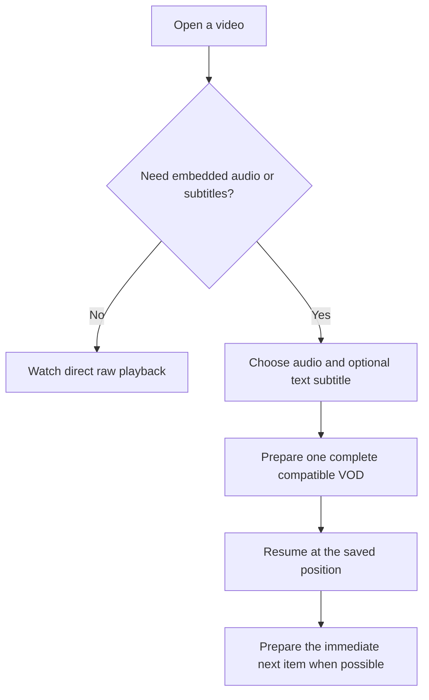

# The Player

[Español](README.es.md)

The Player is a browser video player for a local playlist. It remembers browser progress and can optionally host a temporary room on a trusted LAN.

## Download and start

**Windows portable v1.5.7** — [download the ZIP](https://github.com/Dortecx/The-Player/releases/download/v1.5.7/The-Player-1.5.7-windows.zip), unzip it, then open `The-Player-1.5.7-windows`.



- **`start.cmd`** is local-only. It opens files directly and instantly; choose **Use local embedded tracks** only when you need embedded audio or text subtitles.
- **`LAN.cmd`** is shared mode for one trusted Wi-Fi/LAN. It opens the host library; share the in-app room URL, never a public link.
- Keep the launcher console open and use `Ctrl+C` for normal shutdown. The ZIP already includes Node, FFmpeg, and FFprobe.

## Quick path

### Local playback

1. Run `start.cmd`.
2. Choose **Folder** or **File**, then select a playlist item.
3. For embedded MKV audio/subtitles, choose **Use local embedded tracks**, select the tracks, and apply them.

The direct path stays raw and has no upload or conversion. The explicit track action creates a loopback-only, non-shareable local session. Progress, watched state, and recent activity remain in browser IndexedDB.

### Share on a LAN

1. Run `LAN.cmd` and allow Node through Windows Firewall on **Private** networks if prompted.
2. Add media in the host browser, then use **Copy room link**.
3. Send that complete URL only to people on the same trusted LAN.

The room token is a bearer secret. Guests can control playback but cannot upload, replace, or clear the host library. See [LAN shared playback details](docs/lan-shared-playback.md).

## Embedded tracks at a glance



| Topic | What to expect |
| --- | --- |
| Preparation | The player waits for a complete, validated VOD; it never starts partial HLS. |
| Subtitles | Supported text tracks display through a protected aggregate WebVTT overlay. Image subtitles are unavailable. |
| Cache | Completed compatible renditions are kept in the marked `hls-cache`; delete that folder manually to clear derived media. |
| Resume | Each playlist item keeps a content-bound checkpoint, including quick A/B/C navigation. |
| Recovery | If preparation fails, use the original-video action; your browser must support that file's container and codecs. |

For codecs, HLS routing, conversion states, GPU/CPU fallback, cache safety, and one-ahead navigation, see [selected-track playback details](docs/selected-track-playback.md).

## Run from source or build the portable ZIP

For a source checkout, install Node.js 18+ and npm:

```bash
git clone https://github.com/Dortecx/The-Player.git
cd The-Player
npm run web
```

The source server is local-only by default. To share, start it with `SHARE_LAN=1`.

To build the Windows portable ZIP on Windows:

```powershell
npm run build:portable:win
```

Building requires Windows PowerShell 5.1, Windows `node.exe` 18+, `curl.exe`, and Internet access. The FFmpeg archive is SHA-256-pinned; an interrupted download keeps only a bounded identity-matched partial for safe resume. The build verifies the final hash before extracting it. End users install nothing extra.

Repository: <https://github.com/Dortecx/The-Player> · Release: <https://github.com/Dortecx/The-Player/releases/tag/v1.5.7>

## License

MIT License. See [LICENSE](LICENSE).
