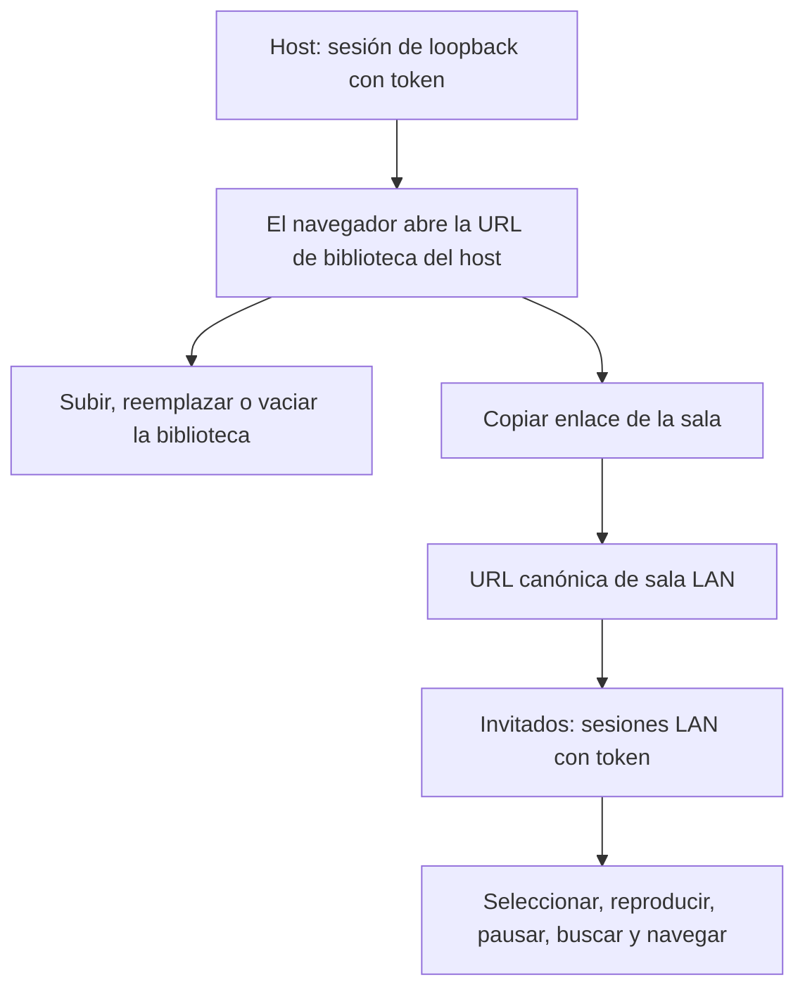
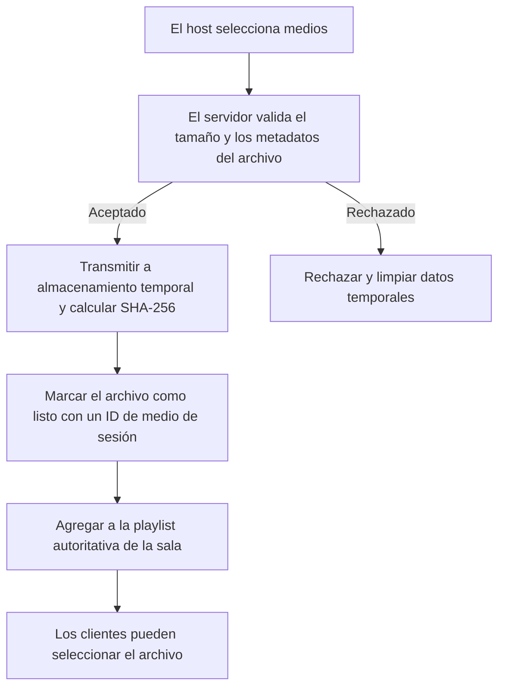
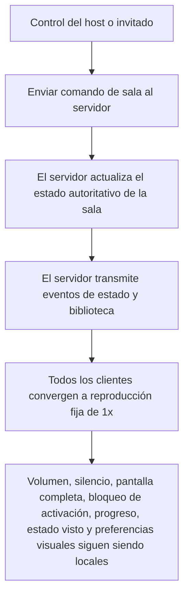

# Detalles de reproducción compartida por LAN

Esta guía complementa el [README en inglés](../README.md) y el [README en español](../README.es.md). Usá la reproducción compartida solo en una red local confiable; no es un servicio para compartir por Internet.

## Roles de host y clientes

Iniciá explícitamente el modo compartido:

- Paquete portátil de Windows: ejecutá `LAN.cmd`.
- Checkout de código fuente en Windows Command Prompt: `set "SHARE_LAN=1" && npm run web`.
- Checkout de código fuente en Windows PowerShell: `$env:SHARE_LAN = '1'; npm run web`.
- Checkout de código fuente en Linux/WSL: `SHARE_LAN=1 npm run web`.

El host y los clientes deben estar en la misma Wi-Fi/LAN, sin aislamiento de clientes de red de invitados. Cuando se solicite, permití el servidor Node a través del Firewall de Windows en redes **privadas**. Los launchers prefieren el puerto `3000`, pero usan el primer puerto disponible hasta `3999`; si hace falta una regla, permití el puerto real que muestra el launcher y la URL de sala generada.

Con el paquete portátil de Windows, `LAN.cmd` espera la URL de biblioteca del host con token y la abre automáticamente en el navegador del host. Mantené abierta su consola mientras la sala esté en uso y usá `Ctrl+C` para solicitar el apagado normal. Windows puede terminar Node antes de la limpieza si la ventana se cierra con la **X**, por lo que los manejadores de señal de Node no pueden garantizar la limpieza inmediata en ese caso. En el siguiente inicio de `LAN.cmd` o `start.cmd`, el launcher elimina de forma segura solo su directorio `runtime-media` marcado antes de iniciar el servidor; se preservan `logs`, los temporales del sistema y los archivos portátiles ajenos. Cuando se abra el navegador, usá el control **Copiar enlace de la sala** dentro de la app para copiar la URL canónica protegida de sala LAN para los invitados; el launcher no la imprime.



| URL o control | Uso |
| --- | --- |
| **URL de biblioteca del host** (`127.0.0.1` con `?token=...`) | El launcher portátil la abre solo en el host para agregar medios o vaciar la biblioteca. |
| **Copiar enlace de la sala** | Usalo en la app del host para copiar sin cambios la URL canónica de LAN para invitados. Incluye el token de portador. |

El servidor selecciona una dirección IPv4 física de Ethernet/Wi-Fi utilizable con preferencia sobre adaptadores virtuales, WSL, Docker, Hyper-V, Hamachi, LogMeIn u otros similares a VPN. Si solo hay adaptadores virtuales disponibles, usa sus direcciones; si no hay ninguna dirección LAN utilizable, recurre de forma segura a la URL de loopback con token. El control de portapapeles de la página usa metadatos de sesión proporcionados por el servidor; no reconstruye un enlace compartido a partir de la dirección del navegador.

### URL de sala de un adaptador virtual inesperado

Si **Copiar enlace de la sala** copia una URL LAN inesperada, por ejemplo, de un adaptador virtual, VPN, Hamachi o LogMeIn, hacé esto solo si no necesitás ese adaptador:

1. Detené el launcher/servidor actual cerrando su consola `LAN.cmd`.
2. En **Configuración** de Windows > **Red e Internet** > **Configuración avanzada de red**, desconectá o deshabilitá temporalmente el adaptador virtual no deseado.
3. Reiniciá `LAN.cmd` y usá **Copiar enlace de la sala** otra vez.
4. Restaurá o reconectá el adaptador después si lo necesitás.

No elimines adaptadores ni modifiques reglas del firewall sin necesidad. No publiques URL de sala ni sus tokens.

### Nota avanzada: acceso privado por Tailscale

The Player no crea automáticamente una URL de sala de Tailscale; el modo LAN prioriza intencionalmente una dirección física de Wi-Fi/Ethernet. Si el host y los invitados ya usan Tailscale, el host puede reemplazar manualmente solo la dirección física de una URL de sala copiada por la dirección Tailscale `100.x.x.x` del host, conservando el puerto y el valor completo de `?token=...`. Los invitados necesitan Tailscale instalado, conectado y autorizado para llegar a la máquina host; no necesitan The Player ni Node.js. Es acceso mediante una red superpuesta privada, no compartir públicamente por Internet. Usá una cuenta Tailscale distinta para cada invitado y compartí solo la máquina host cuando sea posible. Tratá la URL de sala como un secreto de portador y no la publiques.

El token de sala es un secreto de portador: cualquier persona con la URL completa puede ver los medios subidos y controlar la sala hasta que el host detenga el servidor. No lo publiques. Una URL de sala LAN-IP abierta en el host es intencionalmente una sesión de invitado.

Solo una solicitud con token cuyo par TCP real sea loopback (`127/8`, `::1` o loopback mapeado a IPv4) puede subir, reemplazar o vaciar la biblioteca. El servidor no confía en `Host`, `Origin` ni encabezados reenviados para esta decisión. Los invitados pueden usar los controles de reproducción compartida, pero Carpeta, Archivo y Vaciar siguen siendo exclusivos del host.

## Ciclo de carga y límites

El máximo predeterminado es **100 GiB por archivo** (`107374182400` bytes). Antes de iniciar el servidor, configurá `MAX_UPLOAD_BYTES` con un recuento de bytes entero positivo para cambiarlo; los valores decimales y los sufijos `GB`/`GiB` no son válidos.

```bash
MAX_UPLOAD_BYTES=107374182400 SHARE_LAN=1 npm run web
```

El ejemplo establece un límite de 100 GiB en Linux/WSL. En PowerShell, configurá `$env:MAX_UPLOAD_BYTES = '107374182400'` antes del comando de modo compartido. La salida de inicio informa el valor efectivo en bytes y su equivalente en GiB. Una variable modificada no afecta a un listener en ejecución: detenelo e iniciá de nuevo el servidor previsto.

El servidor valida el límite antes de aceptar una carga y transmite las cargas aceptadas a archivos temporales. Las cargas rechazadas, sobredimensionadas, parciales y abortadas se limpian. A cada archivo se le asigna un ID de medio de sesión aleatorio mientras se calcula su identidad de contenido SHA-256 durante la transmisión.



En el panel Playlist del host, los archivos seleccionados avanzan por preparación, porcentaje, bytes transferidos/totales, listo y error. Los archivos listos se agregan de inmediato a la playlist autoritativa de la sala, para que los clientes puedan seleccionarlos mientras los archivos posteriores aún se copian. Una carga posterior nunca reemplaza los medios existentes de la sala ni el estado de reproducción. Vaciar es la acción global independiente que elimina toda la biblioteca de la sala y restablece la reproducción compartida.

Cuando la sala comienza vacía, la primera carga se centra en el área útil del panel. Entra durante 2.5 segundos mediante fragmentos aleatorizados de cuadrados/bloques pequeños; cuando su primer elemento está listo, las representaciones centrada y de pie de página fijo hacen un fundido cruzado sincronizado durante 3 segundos usando el mismo valor continuo de lote. Las cargas posteriores entran directamente en el pie de página centrado con la misma entrada aleatorizada de pequeños píxeles durante 2.5 segundos, mientras solo se desplaza la playlist. El progreso real de bytes de XHR avanza de forma continua sobre el lote seleccionado, incluido el ordinal de cada archivo, sin reiniciarse entre archivos secuenciales. Tras la última carga, se completa una salida aleatorizada de pequeños píxeles/bloques de 2.5 segundos antes de liberar el espacio reservado de la lista. Estas transiciones se desactivan cuando se prefiere movimiento reducido.

Los archivos subidos son temporales y se eliminan durante el apagado normal del servidor. Cerrar una pestaña del navegador no los elimina. Un cierre con X puede impedir esa ruta de apagado, pero el siguiente inicio portátil elimina el directorio `runtime-media` marcado obsoleto; no realiza una limpieza amplia de archivos temporales.

### Caché persistente de transmisiones compatibles terminadas

Los launchers portátiles crean una carpeta `hls-cache` marcada junto a ellos. Solo un VOD CMAF terminado cuyas playlists de medios tengan `#EXT-X-ENDLIST`, cuyos manifiestos no contengan referencias externas/de recorrido/temporales, cuyos artefactos referenciados estén presentes y cuyo init fMP4 valide como H.264/AAC se promueve allí de forma atómica. La clave de caché es un digest SHA-256 de la identidad del contenido subido, índices de audio/subtítulo elegidos e identidades versionadas de ruta/codificador/topología; no contiene ruta de origen ni token de sala. Los manifiestos protegidos reciben el token actual solo al servirse.

La caché **no tiene expulsión automática de forma predeterminada**. Puede usar mucho disco, especialmente con fuentes grandes. Vaciar biblioteca y el apagado normal separan los medios activos pero preservan intencionalmente las entradas terminadas. Para vaciar medios derivados y recuperar espacio, detené The Player y eliminá manualmente solo la carpeta marcada `hls-cache` junto a `start.cmd`/`LAN.cmd`; nunca borres una carpeta sin marcar. Una cuota interna programática positiva en bytes puede habilitar expulsión LRU; una entrada mayor que esa cuota queda solo en sesión y nunca expulsa entradas ajenas.

## Comportamiento y límites de la reproducción compartida



La selección, reproducir/pausar, buscar, Anterior y Saltar siguiente se sincronizan a una velocidad fija de 1×. El volumen, el silencio, la pantalla completa, el bloqueo de activación, las actualizaciones ordinarias de progreso, el estado visto y las preferencias visuales permanecen locales al cliente. Un cliente que elige un destino puede enviar el checkpoint de navegador vinculado a ese contenido como candidato de reanudación; el servidor lo usa solo cuando la sala no tiene un checkpoint positivo para ese mismo contenido.

Para medios cuya inspección al subir informa alternativas, se muestra **Pistas internas** debajo del reproductor. Solo el host localhost puede cambiar el audio o el subtítulo de texto inspeccionado opcional; los invitados ven la elección autoritativa en controles deshabilitados de solo lectura. El host debe usar **Aplicar pistas y recargar** antes de que HLS comience. Hasta entonces, la fuente cruda protegida sigue disponible. Aplicar una elección posterior recarga deliberadamente la fuente compartida y restaura la posición de sala lo más cerca posible según los metadatos; no es un cambio sin cortes.

El navegador carga primero el cliente `hls.js` 1.5.18 incluido, con HLS nativo como alternativa cuando está disponible; no se contacta ningún CDN remoto. El ZIP portátil incluye `public/vendor/hls.js/hls.min.js` y su licencia Apache-2.0. Cada elección aplicada crea un VOD HLS multiplexado CMAF/fMP4 orientado directamente a Chrome MSE. El video H.264 `yuv420p` progresivo de 8 bits y audio AAC-LC mono/estéreo compatibles se copian para preparar más rápido; si solo un flujo es incompatible, se convierte solo ese flujo; en otro caso se convierten ambos a H.264/AAC. La detección de GPU se ejecuta solo en rutas que convierten video. Los subtítulos de texto se convierten independientemente a WebVTT opcional y nunca obligan a convertir A/V. Durante la reproducción de pistas elegidas, el cliente presenta los subtítulos mediante una sola superposición agregada WebVTT completa y protegida; no depende del renderizado segmentado de TextTrack nativo ni de hls.js. Si no hay caché, la sala queda visiblemente en preparación mientras FFmpeg convierte el VOD completo; no se sirve un master protegido y los clientes no adjuntan HLS ni guardan progreso parcial. FFmpeg debe terminar correctamente y el grafo completo debe validar con `#EXT-X-ENDLIST` antes de que la selección esté lista; luego se promueve de forma atómica a la caché persistente cuando es posible (de lo contrario se usa la versión de sesión completa validada). Un acierto posterior con el mismo contenido y las mismas pistas queda listo de inmediato sin FFmpeg, expone la duración VOD completa y restaura una posición guardada por el navegador solo para el mismo SHA-256 de fuente después de los metadatos HLS. No hay grupos HLS de audio alternativo ni cambios de pista de audio de hls.js. Los códecs de subtítulos seleccionables son ASS/SSA, SRT/SubRip, WebVTT, MOV text, text y TTML; los subtítulos de imagen/mapa de bits no están disponibles. El trabajo VOD recibe un límite según la duración (10× la duración inspeccionada más 15 minutos, al menos 30 minutos y como máximo 12 horas); una superación pasa al estado terminal `failed` / `job-timeout`. Si la conversión falla o se cancela, nunca se sirve HLS parcial; la acción explícita para recuperar el video original restablece la ruta cruda protegida y sus metadatos sin rutas ni tokens.

Cuando se usa la alternativa, el navegador de cada cliente debe admitir tanto el contenedor multimedia crudo como sus códecs; un `.mkv`, `.mov` o `.mp4` puede seguir fallando si sus códecs no son compatibles.

Si la reproducción automática con audio está bloqueada para un cliente remoto, ese cliente permanece silenciado para preservar la sincronización. Un aviso sutil en toda la superficie permite que el espectador toque para activar el audio localmente sin afectar la reproducción compartida ni el audio del sistema.

## Gestos móviles en pantalla completa

| Contexto o gesto | Comportamiento |
| --- | --- |
| Superficie elegible | Las interacciones se aplican solo a toques directos sobre el marco seguro de video o el fondo del dock de controles, nunca a botones o rangos. |
| Entrar en pantalla completa | El botón de pantalla completa, `F` y un doble toque fuera de pantalla completa primero solicitan pantalla completa del elemento para el marco de video. Usá la alternativa inmersiva de CSS solo cuando la pantalla completa del elemento no esté disponible, sea rechazada o se confirme que falla. |
| Toque sin movimiento | Muestra los controles. |
| Doble toque en el tercio izquierdo o derecho | Busca 10 segundos hacia atrás o adelante. La respuesta repetida se acumula por cliente (`-10`, `-20` o `+10`, `+20`); cambiar de dirección restablece la etiqueta de ese cliente sin cambiar el comando de búsqueda compartido. |
| Doble toque en el tercio central | Alterna reproducir/pausar y muestra un icono centrado adaptable, más pequeño en teléfonos. |
| Movimiento vertical establecido en el tercio derecho | Se activa solo después de suficiente movimiento y luego ajusta continuamente solo el volumen de video de ese dispositivo en cualquier dirección. El ruido diagonal no se clasifica de forma prematura; el gesto no muestra controles ni busca. |
| Deslizamiento horizontal o brillo | Los deslizamientos horizontales no tienen significado de reproducción. No hay gesto de brillo. |
| Superficie de pantalla completa | Desactiva el desplazamiento táctil y el zoom por pinza para poder capturar los deslizamientos de forma fiable; los botones y rangos conservan las interacciones nativas. |
| Exclusiones | Los gestos no se aplican al rango de búsqueda, las pulsaciones prolongadas ni los menús contextuales. |
| Pantallas anchas | El dock mantiene los controles de búsqueda y reproducción en una fila cuando hay espacio y usa su diseño compacto de dos filas solo cuando es necesario. |

## Validación manual con dos navegadores

1. Iniciá el modo compartido. Confirmá que el navegador del host abra la URL de biblioteca del host con token y subí varios videos pequeños compatibles.
2. Confirmá que la primera carga tenga su entrada centrada de fragmentos de 2.5 segundos y, cuando el primer elemento esté listo, su fundido cruzado sincronizado de 3 segundos al pie de página. Confirmá que las cargas posteriores entren en el pie de página, que los archivos listos aparezcan de inmediato y se puedan seleccionar durante copias posteriores, que el progreso del lote avance continuamente y que la salida del pie de página libere espacio solo después de 2.5 segundos. Repetí con movimiento reducido activado y confirmá que estas transiciones estén desactivadas. Confirmá que Vaciar elimine toda la biblioteca de la sala y restablezca la reproducción compartida.
3. Usá **Copiar enlace de la sala** en el navegador A y abrí la URL completa de sala protegida copiada en el navegador B, otro perfil, dispositivo o cliente LAN. Confirmá que cargue la playlist.
4. Desde ambos navegadores por turnos, seleccioná medios, reproducí, pausá, buscá, usá Anterior y usá Saltar siguiente. Confirmá que el otro navegador converja a reproducción fija de 1×.
5. Subí un MKV con una pista de audio y sin subtítulos, y luego uno con varias pistas de audio y un subtítulo de texto interno compatible. La fixture fMP4 generada es evidencia solo de artefactos: esta comprobación LAN manual es necesaria antes de afirmar reproducción de Chrome. Confirmá que **Pistas internas** esté oculto para medios no inspeccionados y para el elemento de una sola pista sin subtítulos, y visible para el elemento con varias pistas. Confirmá que la reproducción cruda sigue disponible hasta que el host use **Aplicar pistas y recargar**. Aplicá audio y subtítulo desde el host: confirmá que ambos navegadores se recarguen con la misma elección, que se muestre el subtítulo, que el audio vuelva después de la activación local salvo que el espectador haya elegido silencio, que la posición se reanude aproximadamente después de cargar los metadatos HLS y que los controles del invitado permanezcan deshabilitados. Cambiá la elección otra vez y confirmá que se recarga sin afirmar que sea un cambio sin cortes. Elegí un video de origen incompatible o desactivá HLS en un navegador de prueba y confirmá que aparezca el estado localizado de alternativa mientras la reproducción cruda original recupere duración y posibilidad de buscar.
6. Usá el control compacto de portapapeles del encabezado y confirmá su aviso de éxito. Pegá el resultado en una ubicación de prueba segura y confirmá que el token se conserve sin mostrarse en la interfaz de la página.
7. En una sesión LAN de invitado, intentá usar Carpeta, Archivo y Vaciar. Confirmá que cada uno muestre el mensaje exclusivo del host sin abrir un selector ni cambiar la biblioteca. Confirmá que la sesión de host localhost con token pueda realizar esas acciones.
8. En un teléfono o tableta, probá pantalla completa en vertical y horizontal, rotación, las rutas de pantalla completa mediante botón/`F`/doble toque, los dobles toques izquierdo/derecho/central, el gesto de volumen vertical del tercio derecho y los deslizamientos horizontales sin efecto. Confirmá que los controles táctiles y de teclado sigan funcionando, mientras que el zoom por pinza/desplazamiento se suprima solo en la superficie de pantalla completa.
9. Cuando el navegador lo permita, mantené presionado y abrí un menú contextual del marco de video; confirmá que el endurecimiento de la interfaz suprima estos elementos donde sea compatible. Esto no hace inaccesibles los medios transmitidos autorizados.
10. Presioná `Ctrl+C` en la consola de `LAN.cmd` y confirmá que la sesión temporal ya no sea accesible. Por separado, cerrá la consola con la **X**, reiniciá un launcher portátil y confirmá que recupera solo la sesión obsoleta de `runtime-media` sin eliminar `logs`.
